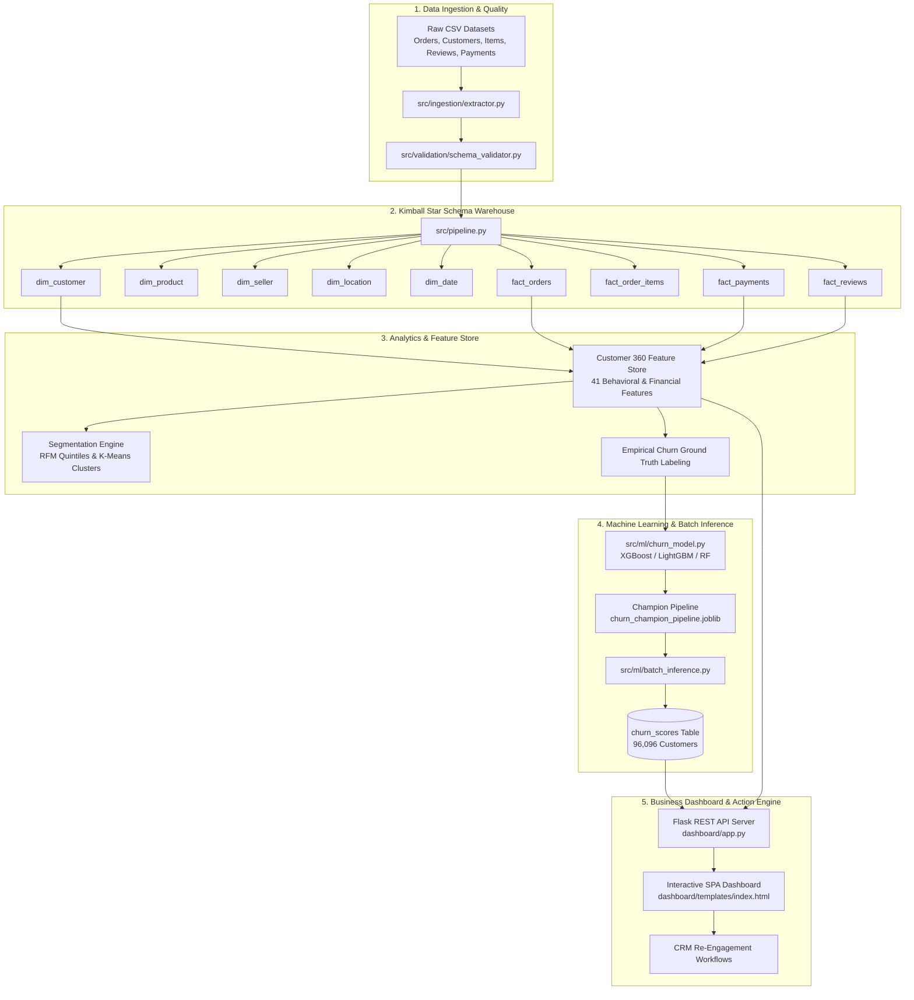

# 🛒 Enterprise Customer 360 & Predictive Churn Intelligence Platform

[](https://www.python.org/)
[](https://www.sqlite.org/)
[](https://xgboost.readthedocs.io/)
[](https://flask.palletsprojects.com/)(#)

An end-to-end, enterprise-grade Data Engineering and Predictive Machine Learning platform built on Brazilian E-Commerce transaction data (Olist). The system extracts, validates, models, and transforms 100K+ raw multi-table records into a Kimball Star Schema warehouse, engineers a 41-feature **Customer 360** profile, segments customers using RFM & K-Means clustering, predicts customer churn probability using an optimized **XGBoost** model, and operationalizes actionable retention strategies via an interactive **Executive Dashboard**.

---

## 🏛️ System Architecture



---

## 🚀 Key Project Highlights & Metrics

- **Dataset Scale:** 96,096 unique customers, 100K+ orders, R$ 13.59M in gross transactions.
- **Data Modeling:** 5 Dimension tables and 4 Fact tables strictly aligned to Kimball dimensional modeling principles.
- **Customer 360 Profile:** 41 engineered features spanning recency, frequency, monetary value (RFM), fulfillment delays, delivery sentiment, payment behavior, and product affinity.
- **Machine Learning Performance:** Champion XGBoost classifier achieving **0.78+ ROC-AUC** with monotonic decile lift and risk calibration.
- **Portfolio Risk Breakdown:**
  - 🔴 **High Risk:** 5,658 customers (5.9%) prioritized for high-touch retention.
  - 🟡 **Medium Risk:** 74,540 customers (77.6%) enrolled in automated re-engagement.
  - 🟢 **Low Risk:** 15,898 customers (16.5%) targeted for loyalty upselling.
- **Production Dashboard:** Dark-mode responsive interface served via Flask with 10 analytical REST endpoints and interactive Chart.js visualizations.

---

## 📁 Repository Structure

```text
├── dashboard/                     # Web Dashboard Application
│   ├── app.py                     # Flask backend with 10 REST endpoints
│   ├── templates/
│   │   └── index.html             # Single-page Chart.js dashboard
│   └── README.md                  # Dashboard documentation & run instructions
│
├── data/                          # Data Storage (Git Ignored for large files)
│   ├── raw/                       # Original Olist CSV datasets
│   └── processed/                 # Processed tables & olist_warehouse.db
│
├── notebooks/                     # Exploratory Data Analysis & Prototyping
│   ├── 01_data_exploration.ipynb  # Dataset inspection & distributions
│   ├── 02_customer_analytics.ipynb# Behavioral analysis
│   └── 03_customer_segmentation.ipynb # RFM & K-Means clustering experiments
│
├── reports/                       # Generated Artifacts & Reports
│   ├── churn_inference_report.html# Executive HTML batch inference report
│   ├── churn_inference_report.xlsx# Multi-sheet spreadsheet with decile lift
│   ├── data_dictionary.md         # Full feature & warehouse dictionary
│   └── data_quality_report.csv    # Schema validation & null audits
│
├── sql/                           # SQL DDL & Warehouse Architecture
│   ├── staging/                   # Staging tables DDL
│   ├── warehouse/                 # Star schema dimensional DDL
│   └── data_model_documentation.md# Entity relationships & schema specs
│
├── src/                           # Production Source Code
│   ├── analytics/
│   │   ├── churn_definition.py    # Ground truth churn labeling
│   │   ├── customer_360.py        # 41-feature Customer 360 generator
│   │   └── segmentation.py        # RFM quintiles & K-Means clustering
│   ├── ingestion/
│   │   └── extractor.py           # Multi-file extraction & staging loader
│   ├── loading/
│   │   └── loader.py              # SQLite/PostgreSQL warehouse loader
│   ├── ml/
│   │   ├── batch_inference.py     # Production scoring & decile ranking
│   │   ├── churn_champion_pipeline.joblib # Serialized champion model
│   │   ├── churn_model.py         # Model training & hyperparameter tuning
│   │   └── inference_report.py    # Report generation utilities
│   ├── transformation/            # Dimensional transformation modules
│   ├── validation/
│   │   └── schema_validator.py    # Great Expectations style data auditor
│   └── pipeline.py                # End-to-end master ETL pipeline orchestrator
│
├── tests/
│   └── test_etl_pipeline.py       # PyTest automated pipeline test suite
│
├── .gitignore                     # Git ignore rules (blocks >100MB databases)
└── README.md                      # Project master documentation
```

---

## 🔄 End-to-End Execution Guide

### 1. Prerequisites & Environment Setup

Clone the repository and install dependencies:

```bash
git clone https://github.com/<your-username>/<your-repo-name>.git
cd <your-repo-name>

python -m venv venv
# On Windows:
venv\Scripts\activate
# On macOS/Linux:
source venv/bin/activate

pip install -r requirements.txt
```

*(If you don't have a `requirements.txt` yet, install core packages: `pip install pandas numpy scikit-learn xgboost flask openpyxl matplotlib seaborn joblib`)*

---

### 2. Run the Full ETL Pipeline
Extracts raw data, validates schemas, builds dimensions/facts, and populates the warehouse:

```bash
python src/pipeline.py
```

### 3. Run Customer 360 Feature Engineering & Segmentation
Generates the 41-feature customer profile and assigns RFM & K-Means segments:

```bash
python src/analytics/customer_360.py
python src/analytics/segmentation.py
python src/analytics/churn_definition.py
```

### 4. Train Churn Prediction Models
Trains baseline models, optimizes champion XGBoost model, and exports the serialized pipeline:

```bash
python src/ml/churn_model.py
```

### 5. Run Batch Scoring & Generate Executive Reports
Scores all 96,096 customers, writes risk deciles to `churn_scores`, and outputs HTML/Excel reports:

```bash
python src/ml/batch_inference.py
```

### 6. Launch the Live Business Dashboard
Start the local analytics dashboard server:

```bash
python dashboard/app.py
```


---

## 📊 Dashboard Modules

The single-page web dashboard provides 5 interactive views:

| View | Purpose | Visualizations |
| :--- | :--- | :--- |
| **📊 Overview** | Executive summary & real-time KPIs | KPI cards, Risk Distribution Donut, Churn Probability Histogram, 2016–2018 Monthly Order/Revenue Trend |
| **⚠️ Risk Analysis** | Model validation & Lift analysis | 10-Decile Lift Bar Chart, Payment Method Churn Comparison, Full Decile Conversion Matrix |
| **🎯 Segments** | Targeted marketing & loyalty insights | Segment Churn vs. Monetary Value, Top 15 Product Category Churn Risk Chart |
| **🗺️ Geography** | Regional logistics & fulfillment health | Top Brazilian States by Churn Rate, High-Risk Volume by State, 27-State Intelligence Matrix |
| **👥 Customers** | Operational CRM intervention engine | Filterable Top 100 High-Risk Customer List with recommended retention actions |

---

## 🛠️ Technology Stack

- **Data Processing & Analytics:** Python, Pandas, NumPy
- **Data Warehouse & SQL:** SQLite, PostgreSQL DDL, Kimball Star Schema
- **Machine Learning & Modeling:** Scikit-Learn, XGBoost, Joblib
- **Web Application & API:** Flask, REST APIs, JSON
- **Frontend & Data Visualization:** HTML5, CSS3 (Dark Mode / Glassmorphism), JavaScript (ES6), Chart.js
- **Quality Assurance & Testing:** PyTest, Logging, Great-Expectations-style Schema Validation

---


