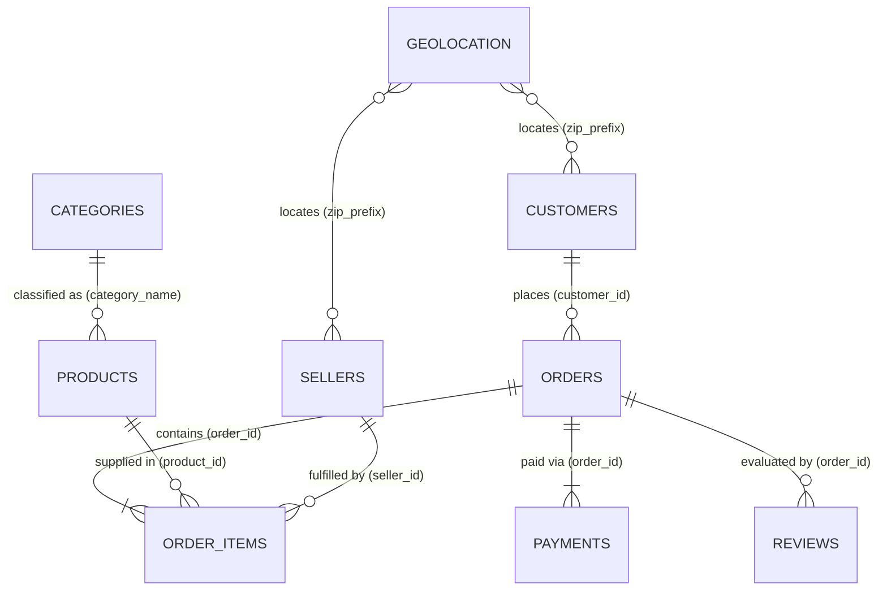

# Olist Brazilian E-Commerce: Comprehensive Data Dictionary

This document provides technical metadata, schemas, completeness scores, integrity relationships, and business interpretations for all 9 raw datasets provided by Olist.

## 1. Executive Summary of Datasets

| Dataset | File Name | Rows | Columns | Duplicates | PK Candidate(s) | Completeness (%) |
|---|---|---|---|---|---|---|
| **customers** | `olist_customers_dataset.csv` | 99,441 | 5 | 0 | customer_id | 100.0% |
| **orders** | `olist_orders_dataset.csv` | 99,441 | 8 | 0 | order_id, customer_id | 99.38% |
| **order_items** | `olist_order_items_dataset.csv` | 112,650 | 7 | 0 | Composite / Non-unique | 100.0% |
| **payments** | `olist_order_payments_dataset.csv` | 103,886 | 5 | 0 | Composite / Non-unique | 100.0% |
| **reviews** | `olist_order_reviews_dataset.csv` | 99,224 | 7 | 0 | Composite / Non-unique | 78.99% |
| **products** | `olist_products_dataset.csv` | 32,951 | 9 | 0 | product_id | 99.17% |
| **sellers** | `olist_sellers_dataset.csv` | 3,095 | 4 | 0 | seller_id | 100.0% |
| **geolocation** | `olist_geolocation_dataset.csv` | 1,000,163 | 5 | 261,831 | Composite / Non-unique | 100.0% |
| **category_translation** | `product_category_name_translation.csv` | 71 | 2 | 0 | product_category_name, product_category_name_english | 100.0% |

---

## 2. Relational Architecture & Entity Relationships

### Key Relational Nuances:
1. **Customer Identity Architecture (`customer_id` vs `customer_unique_id`)**:
   - `customer_id`: Assigned per *order session*. A single buyer placing 3 orders has 3 distinct `customer_id`s.
   - `customer_unique_id`: The true physical customer identity. Essential for RFM, churn analysis, and Customer 360.
2. **Order Line-Items (`order_items`)**:
   - Primary key is composite: `(order_id, order_item_id)`. One order can have multiple items and multiple sellers.
3. **Payments Split (`order_payments`)**:
   - Primary key is composite: `(order_id, payment_sequential)`. Orders can be split across vouchers, credit cards, etc.
4. **Reviews (`order_reviews`)**:
   - Multiple reviews can exist for the same order (`review_id` / `order_id` repeat on rare multi-touch surveys).

---

## 3. Dataset Schemas & Column Attributes

### 3.1 `olist_customers_dataset.csv` (CUSTOMERS)

- **Total Rows:** 99,441
- **Total Columns:** 5
- **Duplicate Rows:** 0
- **Date Columns:** `[]`
- **Numeric Columns:** `['customer_zip_code_prefix']`
- **Categorical Columns:** `['customer_id', 'customer_unique_id', 'customer_city', 'customer_state']`

| Column Name | Inferred Type | Null Count | Null % | Unique Values | Sample Values |
|---|---|---|---|---|---|
| `customer_id` | `object` | 0 | 0.0% | 99,441 | 06b8999e2fba1a1fbc88172c00ba8bc7, 18955e83d337fd6b2def6b18a428ac77 |
| `customer_unique_id` | `object` | 0 | 0.0% | 96,096 | 861eff4711a542e4b93843c6dd7febb0, 290c77bc529b7ac935b93aa66c333dc3 |
| `customer_zip_code_prefix` | `int64` | 0 | 0.0% | 14,994 | 14409, 9790 |
| `customer_city` | `object` | 0 | 0.0% | 4,119 | franca, sao bernardo do campo |
| `customer_state` | `object` | 0 | 0.0% | 27 | SP, SP |

### 3.2 `olist_orders_dataset.csv` (ORDERS)

- **Total Rows:** 99,441
- **Total Columns:** 8
- **Duplicate Rows:** 0
- **Date Columns:** `['order_purchase_timestamp', 'order_delivered_carrier_date', 'order_delivered_customer_date', 'order_estimated_delivery_date']`
- **Numeric Columns:** `[]`
- **Categorical Columns:** `['order_id', 'customer_id', 'order_status', 'order_approved_at']`

| Column Name | Inferred Type | Null Count | Null % | Unique Values | Sample Values |
|---|---|---|---|---|---|
| `order_id` | `object` | 0 | 0.0% | 99,441 | e481f51cbdc54678b7cc49136f2d6af7, 53cdb2fc8bc7dce0b6741e2150273451 |
| `customer_id` | `object` | 0 | 0.0% | 99,441 | 9ef432eb6251297304e76186b10a928d, b0830fb4747a6c6d20dea0b8c802d7ef |
| `order_status` | `object` | 0 | 0.0% | 8 | delivered, delivered |
| `order_purchase_timestamp` | `object` | 0 | 0.0% | 98,875 | 2017-10-02 10:56:33, 2018-07-24 20:41:37 |
| `order_approved_at` | `object` | 160 | 0.16% | 90,733 | 2017-10-02 11:07:15, 2018-07-26 03:24:27 |
| `order_delivered_carrier_date` | `object` | 1,783 | 1.79% | 81,018 | 2017-10-04 19:55:00, 2018-07-26 14:31:00 |
| `order_delivered_customer_date` | `object` | 2,965 | 2.98% | 95,664 | 2017-10-10 21:25:13, 2018-08-07 15:27:45 |
| `order_estimated_delivery_date` | `object` | 0 | 0.0% | 459 | 2017-10-18 00:00:00, 2018-08-13 00:00:00 |

### 3.3 `olist_order_items_dataset.csv` (ORDER_ITEMS)

- **Total Rows:** 112,650
- **Total Columns:** 7
- **Duplicate Rows:** 0
- **Date Columns:** `['shipping_limit_date']`
- **Numeric Columns:** `['order_item_id', 'price', 'freight_value']`
- **Categorical Columns:** `['order_id', 'product_id', 'seller_id']`

| Column Name | Inferred Type | Null Count | Null % | Unique Values | Sample Values |
|---|---|---|---|---|---|
| `order_id` | `object` | 0 | 0.0% | 98,666 | 00010242fe8c5a6d1ba2dd792cb16214, 00018f77f2f0320c557190d7a144bdd3 |
| `order_item_id` | `int64` | 0 | 0.0% | 21 | 1, 1 |
| `product_id` | `object` | 0 | 0.0% | 32,951 | 4244733e06e7ecb4970a6e2683c13e61, e5f2d52b802189ee658865ca93d83a8f |
| `seller_id` | `object` | 0 | 0.0% | 3,095 | 48436dade18ac8b2bce089ec2a041202, dd7ddc04e1b6c2c614352b383efe2d36 |
| `shipping_limit_date` | `object` | 0 | 0.0% | 93,318 | 2017-09-19 09:45:35, 2017-05-03 11:05:13 |
| `price` | `float64` | 0 | 0.0% | 5,968 | 58.9, 239.9 |
| `freight_value` | `float64` | 0 | 0.0% | 6,999 | 13.29, 19.93 |

### 3.4 `olist_order_payments_dataset.csv` (PAYMENTS)

- **Total Rows:** 103,886
- **Total Columns:** 5
- **Duplicate Rows:** 0
- **Date Columns:** `[]`
- **Numeric Columns:** `['payment_sequential', 'payment_installments', 'payment_value']`
- **Categorical Columns:** `['order_id', 'payment_type']`

| Column Name | Inferred Type | Null Count | Null % | Unique Values | Sample Values |
|---|---|---|---|---|---|
| `order_id` | `object` | 0 | 0.0% | 99,440 | b81ef226f3fe1789b1e8b2acac839d17, a9810da82917af2d9aefd1278f1dcfa0 |
| `payment_sequential` | `int64` | 0 | 0.0% | 29 | 1, 1 |
| `payment_type` | `object` | 0 | 0.0% | 5 | credit_card, credit_card |
| `payment_installments` | `int64` | 0 | 0.0% | 24 | 8, 1 |
| `payment_value` | `float64` | 0 | 0.0% | 29,077 | 99.33, 24.39 |

### 3.5 `olist_order_reviews_dataset.csv` (REVIEWS)

- **Total Rows:** 99,224
- **Total Columns:** 7
- **Duplicate Rows:** 0
- **Date Columns:** `['review_creation_date', 'review_answer_timestamp']`
- **Numeric Columns:** `['review_score']`
- **Categorical Columns:** `['review_id', 'order_id', 'review_comment_title', 'review_comment_message']`

| Column Name | Inferred Type | Null Count | Null % | Unique Values | Sample Values |
|---|---|---|---|---|---|
| `review_id` | `object` | 0 | 0.0% | 98,410 | 7bc2406110b926393aa56f80a40eba40, 80e641a11e56f04c1ad469d5645fdfde |
| `order_id` | `object` | 0 | 0.0% | 98,673 | 73fc7af87114b39712e6da79b0a377eb, a548910a1c6147796b98fdf73dbeba33 |
| `review_score` | `int64` | 0 | 0.0% | 5 | 4, 5 |
| `review_comment_title` | `object` | 87,656 | 88.34% | 4,527 | recomendo, Super recomendo |
| `review_comment_message` | `object` | 58,247 | 58.7% | 36,159 | Recebi bem antes do prazo estipulado., Parabéns lojas lannister adorei comprar pela Internet seguro e prático Parabéns a todos feliz Páscoa |
| `review_creation_date` | `object` | 0 | 0.0% | 636 | 2018-01-18 00:00:00, 2018-03-10 00:00:00 |
| `review_answer_timestamp` | `object` | 0 | 0.0% | 98,248 | 2018-01-18 21:46:59, 2018-03-11 03:05:13 |

### 3.6 `olist_products_dataset.csv` (PRODUCTS)

- **Total Rows:** 32,951
- **Total Columns:** 9
- **Duplicate Rows:** 0
- **Date Columns:** `[]`
- **Numeric Columns:** `['product_name_lenght', 'product_description_lenght', 'product_photos_qty', 'product_weight_g', 'product_length_cm', 'product_height_cm', 'product_width_cm']`
- **Categorical Columns:** `['product_id', 'product_category_name']`

| Column Name | Inferred Type | Null Count | Null % | Unique Values | Sample Values |
|---|---|---|---|---|---|
| `product_id` | `object` | 0 | 0.0% | 32,951 | 1e9e8ef04dbcff4541ed26657ea517e5, 3aa071139cb16b67ca9e5dea641aaa2f |
| `product_category_name` | `object` | 610 | 1.85% | 73 | perfumaria, artes |
| `product_name_lenght` | `float64` | 610 | 1.85% | 66 | 40.0, 44.0 |
| `product_description_lenght` | `float64` | 610 | 1.85% | 2,960 | 287.0, 276.0 |
| `product_photos_qty` | `float64` | 610 | 1.85% | 19 | 1.0, 1.0 |
| `product_weight_g` | `float64` | 2 | 0.01% | 2,204 | 225.0, 1000.0 |
| `product_length_cm` | `float64` | 2 | 0.01% | 99 | 16.0, 30.0 |
| `product_height_cm` | `float64` | 2 | 0.01% | 102 | 10.0, 18.0 |
| `product_width_cm` | `float64` | 2 | 0.01% | 95 | 14.0, 20.0 |

### 3.7 `olist_sellers_dataset.csv` (SELLERS)

- **Total Rows:** 3,095
- **Total Columns:** 4
- **Duplicate Rows:** 0
- **Date Columns:** `[]`
- **Numeric Columns:** `['seller_zip_code_prefix']`
- **Categorical Columns:** `['seller_id', 'seller_city', 'seller_state']`

| Column Name | Inferred Type | Null Count | Null % | Unique Values | Sample Values |
|---|---|---|---|---|---|
| `seller_id` | `object` | 0 | 0.0% | 3,095 | 3442f8959a84dea7ee197c632cb2df15, d1b65fc7debc3361ea86b5f14c68d2e2 |
| `seller_zip_code_prefix` | `int64` | 0 | 0.0% | 2,246 | 13023, 13844 |
| `seller_city` | `object` | 0 | 0.0% | 611 | campinas, mogi guacu |
| `seller_state` | `object` | 0 | 0.0% | 23 | SP, SP |

### 3.8 `olist_geolocation_dataset.csv` (GEOLOCATION)

- **Total Rows:** 1,000,163
- **Total Columns:** 5
- **Duplicate Rows:** 261,831
- **Date Columns:** `[]`
- **Numeric Columns:** `['geolocation_zip_code_prefix', 'geolocation_lat', 'geolocation_lng']`
- **Categorical Columns:** `['geolocation_city', 'geolocation_state']`

| Column Name | Inferred Type | Null Count | Null % | Unique Values | Sample Values |
|---|---|---|---|---|---|
| `geolocation_zip_code_prefix` | `int64` | 0 | 0.0% | 19,015 | 1037, 1046 |
| `geolocation_lat` | `float64` | 0 | 0.0% | 717,360 | -23.54562128115268, -23.54608112703553 |
| `geolocation_lng` | `float64` | 0 | 0.0% | 717,613 | -46.63929204800168, -46.64482029837157 |
| `geolocation_city` | `object` | 0 | 0.0% | 8,011 | sao paulo, sao paulo |
| `geolocation_state` | `object` | 0 | 0.0% | 27 | SP, SP |

### 3.9 `product_category_name_translation.csv` (CATEGORY_TRANSLATION)

- **Total Rows:** 71
- **Total Columns:** 2
- **Duplicate Rows:** 0
- **Date Columns:** `[]`
- **Numeric Columns:** `[]`
- **Categorical Columns:** `['product_category_name', 'product_category_name_english']`

| Column Name | Inferred Type | Null Count | Null % | Unique Values | Sample Values |
|---|---|---|---|---|---|
| `product_category_name` | `object` | 0 | 0.0% | 71 | beleza_saude, informatica_acessorios |
| `product_category_name_english` | `object` | 0 | 0.0% | 71 | health_beauty, computers_accessories |

