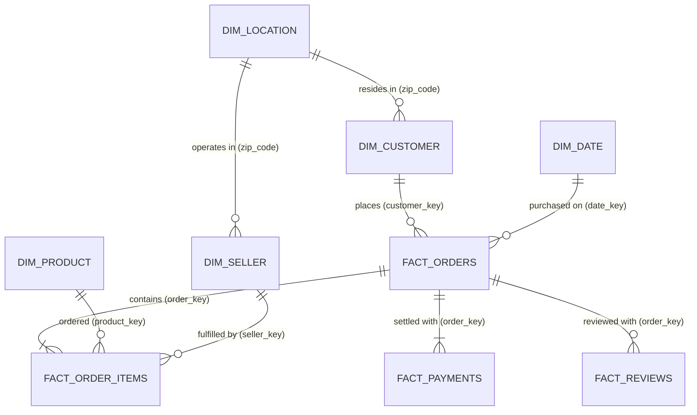

# Olist E-Commerce Dimensional Data Warehouse & Star Schema Specification

## 1. Architecture Overview
This dimensional data warehouse transforms normalized Olist operational records into an optimized **Kimball Star Schema**. It separates multi-grain operational events into distinct Fact tables linked to Conformed Dimensions via surrogate keys.

---

## 2. Staging Layer (`staging` schema)

Staging tables serve as a 1:1 reflection of raw operational files with type standardization and data sanitation:

| Staging Table | Source File | Grain | Primary Key | Description |
|---|---|---|---|---|
| `stg_customers` | `olist_customers_dataset.csv` | 1 row per order session | `customer_id` | Operational customer identity |
| `stg_orders` | `olist_orders_dataset.csv` | 1 row per order | `order_id` | Core lifecycle timestamps and status |
| `stg_order_items` | `olist_order_items_dataset.csv` | 1 row per order line item | `(order_id, order_item_id)` | Product and seller allocation |
| `stg_payments` | `olist_order_payments_dataset.csv` | 1 row per payment transaction | `(order_id, payment_sequential)` | Split tenders and payment types |
| `stg_reviews` | `olist_order_reviews_dataset.csv` | 1 row per review survey | `(review_id, order_id)` | CSAT score and timestamps |
| `stg_products` | `olist_products_dataset.csv` | 1 row per product SKU | `product_id` | Catalog metadata and dimensions |
| `stg_sellers` | `olist_sellers_dataset.csv` | 1 row per merchant | `seller_id` | Merchant locations |
| `stg_geolocation` | `olist_geolocation_dataset.csv` | 1 row per coordinate ping | Composite / clustered | Raw geographic points |
| `stg_category_translation` | `product_category_name_translation.csv` | 1 row per category slug | `product_category_name` | Portuguese-to-English translation |

---

## 3. Dimensional Layer (`warehouse` schema)

### 3.1 Conformed Dimensions

#### `dim_customer`
- **Grain**: 1 row per customer order account (`customer_id`).
- **Surrogate Key**: `customer_key` (SERIAL / INTEGER).
- **Attributes**:
  - `customer_key`: Surrogate primary key.
  - `customer_id`: Operational account token.
  - `customer_unique_id`: Persistent natural person identifier (critical for Customer 360 / RFM).
  - `customer_zip_code`: Zip code prefix.
  - `customer_city`: City name (Title Cased).
  - `customer_state`: Brazilian UF abbreviation (e.g., SP, RJ).

#### `dim_product`
- **Grain**: 1 row per unique product SKU (`product_id`).
- **Surrogate Key**: `product_key`.
- **Attributes**:
  - `product_key`: Surrogate primary key.
  - `product_id`: Catalog SKU hash.
  - `product_category`: English category name (with Portuguese fallback & `'unknown'` for nulls).
  - `product_name_length`, `product_description_length`, `product_photos`: Content richness metrics.
  - `product_weight`, `product_length`, `product_height`, `product_width`: Shipping package physical dimensions.

#### `dim_seller`
- **Grain**: 1 row per merchant (`seller_id`).
- **Surrogate Key**: `seller_key`.
- **Attributes**:
  - `seller_key`: Surrogate primary key.
  - `seller_id`: Operational merchant hash.
  - `seller_city`: Merchant city.
  - `seller_state`: Merchant state code.
  - `seller_zip_code`: Merchant zip prefix.

#### `dim_date`
- **Grain**: 1 row per calendar day (2016-01-01 to 2019-12-31).
- **Surrogate Key**: `date_key` (Format: `YYYYMMDD`).
- **Attributes**:
  - `date_key`: Integer surrogate key.
  - `date`: Standard ISO date.
  - `year`, `quarter`, `month`, `month_name`, `week`, `day`, `weekday`.

#### `dim_location`
- **Grain**: 1 row per zip code prefix (`zip_code`).
- **Surrogate Key**: `location_key`.
- **Attributes**:
  - `location_key`: Surrogate primary key.
  - `zip_code`: 5-digit zip code prefix.
  - `city`: Standardized modal city name.
  - `state`: Standardized modal state code.
  - `latitude`: Robust median latitude.
  - `longitude`: Robust median longitude.

---

## 4. Fact Layer (`warehouse` schema)

### 4.1 `fact_orders`
- **Grain**: 1 row per order placed on the platform.
- **Keys & References**:
  - `order_key` (PK, Surrogate)
  - `customer_key` (FK $\rightarrow$ `dim_customer`)
- **Degenerate Dimensions**:
  - `order_id`: Operational identifier.
  - `order_status`: Order fulfillment state (`delivered`, `shipped`, `canceled`, etc.).
- **Timestamps & Measures**:
  - `purchase_date`, `approval_date`, `carrier_date`, `delivery_date`, `estimated_delivery_date`.
  - `delivery_delay_days`: Calculated as `(delivery_date - estimated_delivery_date)`. Positive indicates late delivery; negative indicates early delivery.

### 4.2 `fact_order_items`
- **Grain**: 1 row per order line item.
- **Keys & References**:
  - `order_item_key` (PK, Surrogate)
  - `order_key` (FK $\rightarrow$ `fact_orders`)
  - `product_key` (FK $\rightarrow$ `dim_product`)
  - `seller_key` (FK $\rightarrow$ `dim_seller`)
- **Degenerate Dimensions**:
  - `order_item_id`: Item sequential index within order.
- **Measures**:
  - `price`: Unit price of SKU in BRL.
  - `freight_value`: Shipping fee allocated to line item in BRL.
  - `total_item_value`: Computed as `(price + freight_value)`.

### 4.3 `fact_payments`
- **Grain**: 1 row per payment transaction installment / split.
- **Keys & References**:
  - `payment_key` (PK, Surrogate)
  - `order_key` (FK $\rightarrow$ `fact_orders`)
- **Attributes & Measures**:
  - `payment_type`: Method of tender (`credit_card`, `boleto`, `voucher`, `debit_card`).
  - `payment_installments`: Financing tenure.
  - `payment_value`: Transaction amount in BRL.

### 4.4 `fact_reviews`
- **Grain**: 1 row per customer review evaluation.
- **Keys & References**:
  - `review_key` (PK, Surrogate)
  - `order_key` (FK $\rightarrow$ `fact_orders`)
- **Attributes & Measures**:
  - `review_score`: Rating integer from 1 to 5.
  - `review_creation_date`: Survey distribution timestamp.
  - `review_answer_date`: Response completion timestamp.

---

## 5. Storage & Delivery Formats
1. **Production SQL Scripts**:
   - `sql/staging/01_create_staging_tables.sql`
   - `sql/warehouse/02_create_star_schema.sql`
   - `sql/warehouse/03_load_warehouse_transforms.sql`
2. **Indexed Relational Warehouse**:
   - `data/processed/olist_warehouse.db` (57.2 MB SQLite warehouse ready for zero-latency queries)
3. **Processed Analytical Parquet/CSV Marts**:
   - `data/processed/*.csv` (Ready for Power BI, Python ETL, and Machine Learning)
